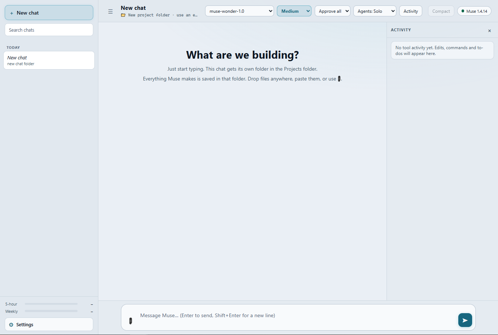
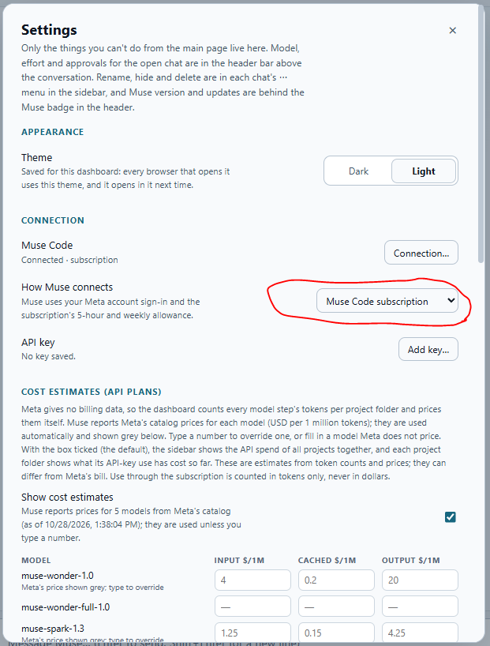

# Muse Dashboard

A local, browser-based workspace for **Meta's Muse Code**. Chat with Muse, give every
conversation its own project folder or point it at an existing one, approve its actions,
watch its tools and subagents work, and keep an eye on tokens and your subscription, all
from one page that runs on your own computer.

The dashboard drives the Muse Code you already have installed (`muse serve`, through
Meta's official [`@muse-code/sdk`](https://github.com/meta-models/muse-code-sdk)). It uses
the same sign-in and the same session history as Muse in your terminal, so chats started
in either place show up in both.



Created by **Adam S. Barnett**.

---

## Contents

- [Features](#features)
- [Requirements](#requirements)
- [Quick start](#quick-start)
- [Connecting to Muse Code](#connecting-to-muse-code)
- [Skills](#skills)
- [The execution policy](#the-execution-policy)
- [Using the dashboard](#using-the-dashboard)
- [Muse in a terminal](#muse-in-a-terminal)
- [Configuration](#configuration)
- [Muse versions and updates](#muse-versions-and-updates)
- [Troubleshooting](#troubleshooting)
- [Security and privacy](#security-and-privacy)
- [Project layout](#project-layout)
- [Development and tests](#development-and-tests)
- [Credits](#credits)

## Features

- **Chat with Muse Code** in a clean, streaming chat view with Markdown and code highlighting.
- **A project folder per chat**: name a new project and its folder is created under `Projects\`,
  or open any existing folder, like VS Code's *Open Folder*.
- **Connect dialog**: the dashboard checks at launch that Muse Code is installed and signed in,
  and walks you through installing it or signing in with your Meta account if not.
- **Subscription or API key**: run Muse on your Muse Code subscription or on a Meta API key
  (billed per use), switchable in Settings; the key is checked with Meta and kept encrypted by
  the operating system.
- **Per-chat controls** in the header: model, reasoning effort, approvals (*Approve all* or
  *Ask me*), and Agents mode (*Solo*, *Auto*, *Parallel*).
- **Approvals** as cards with Allow / Deny when Muse wants to run a command or edit a file.
- **Activity panel**: tool calls, shell commands, edits, web searches, subagents and workflows,
  each expandable, so the conversation stays readable.
- **Cost visibility**: steps and tokens under every reply, a live meter while Muse works, totals
  per chat in the sidebar, context fill (`ctx %`), and your 5-hour and weekly subscription usage.
- **Cost estimates for API keys**: every model step's tokens are counted per project folder and
  priced from Meta's catalog (or prices you type), so each folder and the sidebar show an
  estimated dollar figure; subscription use is never counted in dollars.
- **Talk to Muse while it works**: a message sent during a reply waits in a card above the
  composer and goes when the reply ends; from the card you can nudge the running reply with it,
  push it through instead, or take it back.
- **Scheduled jobs**: when Muse schedules its own follow-up with its cron tools (a build to wait
  for, a check later), the Activity head shows a countdown to the next run, the sidebar marks the
  chat, and the job can be cancelled from there.
- **Muse preset switch**: the leaner `miniswe` preset is on by default (about 40% fewer tokens per
  model step in our tests); one Settings switch goes back to Muse's default preset.
- **Budgets**: a notice and an automatic stop for runaway replies (model steps) and for
  subagents (input tokens).
- **Snapshots**: before Muse works on an existing folder, save a Git snapshot and undo every
  change later with one click, without touching your branches or commits.
- **Safe delete**: deleting a chat moves its `Projects\` folder to the Recycle Bin (with a clear
  warning when it is too large to be kept there); folders opened from elsewhere are never
  deleted by the dashboard.
- **GitHub repositories**: paste a repository link into a new chat and the dashboard clones it,
  so Muse can change it, commit and push to GitHub with your own Git sign-in.
- **Attachments**: drop, paste or pick files; images are also sent to the model as pictures.
- **Bundled skill** (`game-3d-assets`) and a one-command skill installer.
- **Safe by default**: listens on `127.0.0.1` only, a private access token per run, strict
  content security policy, nothing loaded from the internet.
- **Self-managing**: reopens the running copy if you start it twice, stops by itself after the
  last tab closes, never leaves Muse processes behind, and keeps Muse up to date.

## Requirements

| What | Notes |
|---|---|
| **Windows 10 or 11** | The dashboard is developed and tested on Windows. macOS and Linux are supported through `start-dashboard.sh` (the native folder dialog is Windows-only; other systems use the in-page folder browser). |
| **Node.js 20 or newer** | [nodejs.org](https://nodejs.org). The dashboard has no build step. |
| **Muse Code** (the `muse` CLI) | Installed with Meta's installer, see below. The bundled SDK is 1.4.13 and speaks Muse's protocol schema v1. |
| **A Meta account with Muse Code access** | You sign in once; the dashboard and the terminal share the sign-in. |
| **Git** (optional) | Needed only for folder snapshots and undo. |

## Quick start

1. **Install Node.js 20+** from [nodejs.org](https://nodejs.org).

2. **Install Muse Code** with Meta's installer. In **PowerShell** (Windows):

   ```powershell
   irm https://dev.meta.ai/install.ps1 | iex
   ```

   or in a terminal on **macOS / Linux**:

   ```sh
   curl -fsSL https://dev.meta.ai/install.sh | bash
   ```

   Open a new terminal afterwards and check that `muse --version` works.

3. **Sign in to Muse Code** with your Meta account:

   ```sh
   muse login
   ```

   You can also skip this step: the dashboard notices that you are not signed in and offers
   **Sign in with Meta** (see [Connecting to Muse Code](#connecting-to-muse-code)).

4. **Get the dashboard**: clone this repository (or download it as a ZIP and extract it):

   ```sh
   git clone https://github.com/adamspencerbarnett-afk/Muse_Dashboard.git Muse_Dashboard_v1
   ```

5. **Start it**:
   - Windows: double-click **`start-dashboard.bat`**.
   - macOS / Linux: run **`./start-dashboard.sh`**.

   The first start installs the dashboard's dependencies (`npm ci`, a few seconds) and creates
   your own `config.json` from `config.example.json`. Your browser then opens on the dashboard.

6. **Optional: install the bundled skill** (one time, see [Skills](#skills)):

   ```sh
   npm run install-skills
   ```

That's it. Click **New chat**, name a project, and start typing.

## Connecting to Muse Code

### How the dashboard finds and talks to Muse

The dashboard uses exactly the Muse Code you use in the terminal; nothing is installed
separately:

1. It looks for Muse's launcher on your `PATH`, and in Meta's default install folder
   (`%LOCALAPPDATA%\Programs\muse` on Windows, `~/.local/bin` elsewhere).
2. On Windows it starts the active Muse binary next to the launcher (the one named in
   `.muse-version`) as `muse serve`, the same binary the `muse` command runs.
3. It talks to that background process over the Muse Session Protocol through Meta's SDK.

Because it is the same Muse, it also shares:

- **The sign-in.** Whatever account `muse login` signed into (Muse keeps it in
  `~/.config/muse/auth.json`), unless you choose an API key (next section).
- **The session history.** Dashboard chats appear in `muse resume` in the terminal. Sessions you
  start in the terminal show in the sidebar when they work inside this dashboard's `Projects\`
  folder (Settings → *Show chats from outside this dashboard* lists the rest).

To use a specific Muse binary instead, set `museBin` in `config.json` to its full path.

### Subscription or API key

Muse can run on your **Muse Code subscription** (the Meta account sign-in, with its 5-hour and
weekly allowance) or on a **Meta API key** (billed per use by Meta). Choose in
**Settings → Connection → How Muse connects**:



- **Add an API key:** **Add key…** (or **Use an API key** in the Connect dialog). Paste a key
  from [dev.meta.ai](https://dev.meta.ai) and click **Check & save**: the dashboard asks Meta
  whether the key works (a free model-list request, no reply is run), saves it, and switches.
  If Meta cannot be reached, **Save without checking** is offered.
- **Switch back and forth** with the **How Muse connects** dropdown. The subscription sign-in is
  never touched by a key, so no new sign-in is needed. Muse restarts with the new connection as
  soon as no reply is running.
- **Remove** deletes the saved key; Muse goes back to the subscription.

How the key is kept:

- Encrypted by the operating system for your user account only: Windows DPAPI (the encrypted
  text is in `data\connection.json`; a copy taken to another user or PC cannot be read), the
  macOS Keychain, or the Linux Secret Service (`secret-tool`, e.g. GNOME Keyring). With no
  secure store available, the dashboard does not save keys; set `META_API_KEY` instead.
- Given only to the Muse processes the dashboard starts (as `META_API_KEY`). Muse in a terminal
  keeps its own sign-in. The page only ever shows the key's last four characters, and the key
  is never written to a log, `config.json` or the chat index.
- Muse's own `muse auth set` is not used: it would store the key in plain text in the same place
  as the subscription sign-in, replacing it.

If the dashboard is started with `META_API_KEY` already set in the environment, the dropdown also
offers **META_API_KEY (environment)**, which is the default until you choose. In subscription mode
the dashboard removes any inherited `META_API_KEY`, so Muse never bills a key you did not choose.

In API-key mode the sidebar shows **API key · estimated spend** with one **Total** over every
project folder instead of the subscription bars (Muse reports no allowance for a key). The models
offered follow the key: Muse lists them itself.

### Cost estimates (API plans)

Meta gives no billing data (no usage or billing endpoint; completions return token counts only),
so the dashboard counts every model step's fresh, cached and output tokens per project folder,
under the connection it ran on (API key or subscription), and prices them when shown. Prices come
from Muse's model catalog (Meta reports USD per 1M tokens per model; they appear a little after a
Muse start and the dashboard remembers the last ones seen) and are shown grey in **Settings →
Cost estimates**; type a number to override one or to price a model Meta does not. Estimates are
on by default (untick **Show cost estimates** to hide them). Each chat's folder shows `≈ $3.42`
on its sidebar row and in a header chip (hover for the per-model breakdown). Only API-key use
becomes dollars; on the subscription (a flat fee) no dollar figure is shown anywhere, though the
tokens are still counted, so switching to a key shows them priced. A price change re-prices all
history at once; a
model with no price marks the estimate "+ unpriced". These are estimates from token counts and
prices and can differ from Meta's bill. A folder's record ends when the folder is deleted; Muse
used in a terminal is not counted.

### The Connect dialog

At launch (once any Muse update has finished) the dashboard asks Muse `muse usage --json`, a
quick check that needs no model call. If something is wrong, the **Connect** dialog opens by
itself and a **⚠** button appears in the header until it is fixed:

| What the dialog says | What to do |
|---|---|
| **Sign in to Muse Code** | Click **Sign in with Meta**. On Windows a small window opens with Meta's sign-in code and your browser opens to approve it; once you approve, the dashboard continues by itself. On macOS / Linux the dialog shows `muse login` to run in a terminal; then click **Check again**. No subscription? Click **Use an API key** instead. |
| **Meta refused the API key** | A reply failed because Meta did not accept the key (revoked, or out of credit). Click **Replace key**, or **Use subscription**. |
| **Install Muse Code** | Run the installer command shown (also in [Quick start](#quick-start)), then click **Check again**. No restart is needed. |
| **Muse Code did not start** | The dialog shows Muse's own error. See [Troubleshooting](#troubleshooting), then click **Check again**. |

The dialog also opens when a reply fails because the sign-in is missing or has expired, or the
key was refused. You can open it any time from **Settings → Connection → Connection…**; that row
also shows the subscription tier (or *API key*) once connected. With an API key, the check only
confirms that Muse has a key (Muse cannot test one); **Check & save** tested it with Meta.

## Skills

Skills are instructions Muse Code reads when a task calls for them. They are installed into
**Muse itself** (for your user account), not into the dashboard, so they are a separate,
one-time setup step and they work in the terminal too.

**Bundled skill**

| Skill | What it does | Needs |
|---|---|---|
| `game-3d-assets` (`skills/game-3d-assets/SKILL.md`) | Builds game-ready 3D models with Blender from a rebuildable Python script, exports GLB, and checks them in the game's own three.js renderer (team colours, animation, framing, measurements). | [Blender](https://www.blender.org/download/) for building models. The skill finds Blender even when it is not on `PATH`. |

**Install or update the bundled skills**

```sh
npm run install-skills
```

This runs Muse's own `muse skills install <folder> --scope user --force` for every folder in
`skills/`. Muse keeps its own copy, so run it again after you edit a skill, then restart the
dashboard (**Settings → Restart**). Check what Muse has installed with
`muse skills list --source user`.

**Add your own skill**: create `skills/<skill-name>/SKILL.md` that starts with front matter
(`name:` and `description:`; the description tells Muse when to use it), check it with
`muse skills validate skills/<skill-name>`, then run `npm run install-skills`.

## The execution policy

`EXECUTION-POLICY.md` holds the working rules the dashboard gives Muse with every request
(as Muse's developer prompt): quality first, start from the project's `MASTER.md` and
`LOG.md`, read every file before changing it, verify through the real interface, and report
honestly what was and was not verified.

- Edit it to change how Muse works for you, then restart the dashboard (**Settings → Restart**).
- Set `"museDeveloperPrompt": null` in `config.json` to send no policy at all.
- Every project folder the dashboard creates gets three starter files: `MASTER.md` (project
  notes), `LOG.md` (session log) and `AGENTS.md`. Muse loads `AGENTS.md` as project rules
  whenever it works in the folder, including from the terminal; it points to the policy file in
  your dashboard folder, so the policy is never copied per project.

## Using the dashboard

### Chats and folders

- **New chat** (or `Ctrl+Shift+O`) opens a popup with two tabs:
  - **New project**: name the chat and its folder is created right away as
    `Projects\<chat-name>\` (for example *Kitchen redesign* → `Projects\kitchen-redesign\`).
    Everything Muse makes for the chat goes there. If your first message names an existing folder
    (`…the game in C:\Games\Neon…`), the dashboard asks **Work in this folder?** so Muse can work
    there directly instead.
  - **Open folder…**: Muse works on an existing folder. **Browse…** opens the Windows folder
    dialog (the in-page browser elsewhere), or pick a recent folder. Nothing is moved or copied.
    If the folder has no `AGENTS.md`, you can tick **Add starter files** (existing files are never
    overwritten). The popup warns when another chat already uses the folder.
- **GitHub link**: if the first message of a new project links a repository
  (`…fix the README in https://github.com/you/your-repo`), the dashboard asks **Clone this GitHub
  repository?** and runs the chat in `Projects\<repo>\` (or in a copy you already have, found by
  its `origin`). Muse is told to pull first, then commit and push its finished changes to the
  current branch.
  - **Sign-in** is Git's own: on Windows, Git Credential Manager (part of Git for Windows) opens a
    GitHub sign-in in the browser the first time a push needs it and remembers it. The dashboard
    never sees or stores a password or token. If you already push from VS Code or a terminal,
    nothing more is needed.
  - **Commit name**: if Git has no `user.name` / `user.email`, the clone gets your GitHub account's
    no-reply address (`<id>+<login>@users.noreply.github.com`), so a personal email never ends up
    in a public repository. Your global Git settings are not changed.
  - **Safety**: a `pre-push` hook in each clone refuses force-pushes and deleting branches on
    GitHub. The dashboard's `MASTER.md`, `LOG.md` and `AGENTS.md` stay local (listed in
    `.git/info/exclude`) unless the repository already has its own; a repository's own
    `AGENTS.md` is never changed.
- **Snapshot**: for a folder not tracked by Git, or a Git repository with uncommitted changes, the
  popup offers **Save a snapshot first**. Later, ⋯ → **Undo changes since snapshot…** puts the
  folder back exactly as it was: changed and deleted files come back, files added since are
  removed. Snapshots live under `refs/muse-dashboard/` in Git and never change your branch,
  commits or staged files. Files Git ignores are left alone; folders over 20,000 files or 1 GB are
  refused.
- **⚠ Untrusted folder**: Muse ignores a folder's `AGENTS.md` and hides subagents unless the
  folder, or the root of the Git repository it is in, is trusted in Muse. Click the chip to trust
  it. It applies from the chat's first message and to new chats in that folder. Tip: if you cloned
  the dashboard with Git, trusting the dashboard folder once (run `muse` in it and choose Trust)
  trusts every chat under `Projects\`.
- The Muse session starts with your first message. Before that, click the 📁 line under the title
  to switch folders.

### Sidebar

- Lists **this dashboard's chats**, grouped by date, with search: the chats made here, plus Muse
  sessions working inside this dashboard's `Projects\` folder (for example started with
  `muse-here.cmd`). Muse keeps one session list for your whole account, shared by the terminal
  and every copy of the dashboard, so a fresh copy starts with an empty sidebar.
  Settings → *Show chats from outside this dashboard* also lists the other sessions (dimmed);
  sending a message in one makes it this dashboard's chat.
- Under each chat: its **new input · output** tokens (hover for the cached re-reads).
- Above Settings: your subscription's **5-hour** and **weekly** usage, as Muse reports it while
  replies run (hover for reset times).
- The **⋯** menu: **Rename**, **Hide** (Settings → *Show hidden chats* brings them back),
  **Remove** (off the dashboard, folder kept), **Delete…** (see below), **Copy folder path**,
  and **Undo changes since snapshot…** when a snapshot exists. Muse has no way to erase its own
  session log, but a removed or deleted chat never reappears in the dashboard.
- **Delete…** is offered only for chats whose folder is inside the dashboard's `Projects\`
  folder, and it moves that folder to the **Recycle Bin** (macOS / Linux: the Trash), where you
  can restore it. The dialog shows the folder and its size first.
  - **Folders opened from elsewhere** (*Open folder…*, a folder named in a message, a cloned
    repository outside `Projects\`) are never deleted by the dashboard: use **Remove**, and delete
    the folder yourself if you no longer need it.
  - **Too large for the Recycle Bin:** Windows deletes for good anything bigger than a drive's
    Recycle Bin limit (or on a drive without one). The dashboard checks that limit first; if the
    folder does not fit, the dialog says so and asks **Delete permanently?** (or Cancel to keep
    it). If Windows still does not keep a folder, the dashboard tells you it was deleted
    permanently.
  - A folder another chat still works in is not deleted.

### While Muse works

- **Approvals**: with **Ask me**, a card appears whenever Muse wants to run a command or edit a
  file; choose **Allow** or **Deny** (some choices accept a note to Muse). **Approve all** answers
  ordinary requests for you; protected files still ask.
- **Stop** interrupts the reply and also stops its subagents and workflows, which Muse would
  otherwise keep running after the reply ends.
- **Activity** (right panel): every tool call, command, edit, web search, subagent and workflow,
  with its status; click one to see its input, output or result, or a subagent's own transcript.
- **Under each reply**: model steps, new input, output and cached tokens, and time. A reply that
  reaches `turnStepWarn` steps (80) shows a notice; at `turnStepLimit` (250) it is stopped and you
  can send *continue*.
- **ctx %** shows how full the chat's context is; **Compact** compacts it now (Muse also compacts
  by itself near the limit).
- **Opening a chat** shows its newest replies; **Load earlier messages** pages back. Opening only
  reads the history; Muse loads the chat when you start typing.
- **Sending while a reply runs**: by default the message waits in a card above the composer and
  goes when the reply ends. From the card, **Nudge now** hands it to the running reply at its next
  model step (the work carries on with your note in mind, shown as *You · nudge*), **Push now**
  interrupts the reply and sends it instead, and **Recall** takes it back into the composer.
  **Settings → While a reply runs** makes Enter nudge instead of queue.
- **Scheduled jobs**: when Muse schedules a follow-up with its own cron tools (the execution
  policy asks it to for a build, deploy or check it must wait for), the Activity head shows
  **Wakes in 4m 10s** with a pulsing dot (orange when due, green while the woken reply runs), the
  Activity button and the sidebar row show a mini countdown, and each run appears in the
  conversation as *Muse woke up for a scheduled job*. Click the chip to see or cancel a job (Muse
  is asked to delete it). Jobs run only while the dashboard is open; chats with a job are kept
  loaded, reloaded at the next start, and keep the dashboard from stopping for idleness. After
  `cronRunWarn` runs of one job (10) a notice suggests cancelling it.

### Agents mode (per chat)

- **Solo** (default): Muse works alone with no subagents. The cheapest and, in practice, as fast
  as the other modes on most tasks.
- **Auto**: Muse decides (it usually works alone).
- **Parallel**: each message asks Muse to split independent parts across workflow children on
  `agentHelperModel`, at most `agentMaxChildren` at once. Faster on large multi-part work, costs
  more. Subagent tokens are added to the reply summary and the sidebar total; `agentTokenWarn` /
  `agentTokenLimit` warn about and stop runaway subagents.

### Attachments

Use 📎, drag and drop anywhere, or paste (`Ctrl+V`). Files are saved in the chat's folder
(`attachments\`, or `.muse-uploads\<chat-id>\` inside an existing project) and given to Muse as
`@relative/path`. Images (PNG, JPEG, GIF, WebP up to 15 MB) are also sent as pictures. The same
file uploaded twice in a chat is stored once.

### Header and Settings

- **Muse badge** (top right): the running Muse version; click for details and **Check for
  updates now**. Blue dot: just updated. Orange: update available or the check failed. Grey
  pulsing: checking. Red: problem.
- **Settings**: the connection (status, subscription or API key, the saved key), cost estimates
  (the price table), show hidden chats, show chats from outside this dashboard, the starting
  effort and approvals for new chats, what Enter does while a reply runs, the **miniswe** preset
  switch (on by default: a leaner Muse with shell-centred edits and a smaller fixed prompt, about
  40% fewer tokens per model step at the same correctness in our tests; web search is off under
  it since the preset has no web tools; off = Muse's default preset; applies to the next Muse
  start, which happens once nothing is running), and **Restart** (restarts the dashboard and Muse
  and reloads the page; refused while a reply runs).

### Starting and stopping

- Starting it again while it runs just reopens the running dashboard.
- It stops by itself a while after you close the last dashboard tab (`idleShutdownSeconds`, never
  in the middle of a reply), or close its window / press `Ctrl+C`. The Muse processes it started
  always stop with it.
- Optional flags: `start-dashboard.bat --port 4321` (preferred port, falls back to a free one),
  `--no-open`, `--debug`.

### Moving the dashboard folder

Everything the dashboard keeps lives in its own folder: `Projects\`, `data\` and `config.json`
(relative `projectsDir` / `dataDir` settings are relative to the dashboard folder). To move it,
stop it, cut and paste the whole folder, and start it from the new place:

- Chats made in `Projects\` follow the move: their folders, recent folders and snapshots point to
  the new place, and new chats go into the new `Projects\`.
- Starter `AGENTS.md` files in `Projects\` name `EXECUTION-POLICY.md` by a relative path, so they
  keep working.
- Chats that work in a folder outside the dashboard (*Open folder…*) are not affected.
- Limits (Muse's own records): a Muse session keeps the folder it started in, so an old chat's
  history still opens, but continuing it says the old folder is gone; start a new chat in the
  same project folder to keep working. Muse's folder trust is stored by path, so trust the
  moved folders again (the ⚠ chip).

## Muse in a terminal

On Windows, **`muse-here.cmd`** (`muse-here [folder]`) starts Muse in a terminal with the same
quality settings the dashboard uses: no approval prompts (the OS sandbox stays on), tool output
kept in context, and compaction sized for about 256k tokens. It never starts in
`C:\Windows\System32`. The execution policy reaches terminal sessions through each project's
`AGENTS.md`. On macOS / Linux the equivalent is:

```sh
muse --approval-mode never --approval-judge off -c context_compaction.tool_result_clearing_enabled=false -c context_compaction.provider_context_limit_tokens=256000
```

## Configuration

Settings live in **`config.json`**, created from `config.example.json` on the first start (edit
it any time; **Settings → Restart** applies the change). It stays on your computer and is not
committed to Git.

| Key | Default | Meaning |
|---|---|---|
| `preferredPort` | `0` | `0` = any free port |
| `idleShutdownSeconds` | `120` | stop this long after the last tab closes; `0` = never |
| `open` | `true` | open the browser at start |
| `museBin` | `null` | full path to a Muse binary (found automatically otherwise) |
| `approvalMode` | `onRequest` | starting approvals for new chats: `allowAll`, `promptUnmatched`, `onRequest`, `denyUnmatched` |
| `sandbox` | `true` | `false` runs Muse with `--disable-sandbox` |
| `sandboxFallback` | `true` | if Muse reports its OS sandbox unavailable, restart it once without the sandbox so chats still work (approvals still apply); `false` = stay sandboxed-only |
| `sandboxNetwork` | `null` | value for Muse's `--sandbox-network` |
| `trustWorkspace` | `false` | run Muse with `--trust-workspace` (trust every folder) |
| `model` | `null` | model for new chats (Muse's default otherwise) |
| `reasoningEffort` | `null` | effort for new chats (Muse's default, high, otherwise) |
| `maxUploadMB` | `200` | largest attachment |
| `historyTurns` | `6` | replies shown when a chat opens |
| `maxLoadedSessions` | `6` | sessions kept loaded in Muse; the least recently used idle ones are unloaded |
| `turnStepWarn` / `turnStepLimit` | `80` / `250` | notice / stop when one reply takes this many model steps (`0` = never) |
| `agentMode` | `solo` | Agents mode for chats that have not picked one: `solo`, `auto`, `parallel` |
| `agentHelperModel` / `agentHelperEffort` | `muse-spark-1.3` / `medium` | model and effort Parallel asks its children to use |
| `agentMaxChildren` | `4` | children at once in Parallel |
| `agentTokenWarn` / `agentTokenLimit` | `1500000` / `4000000` | notice / stop when one reply's subagents have read this many input tokens (`0` = never) |
| `agentStallMinutes` | `10` | notice when a working subagent has shown no progress this long (`0` = never) |
| `cronRunWarn` | `10` | notice once when one scheduled job (Muse's cron tools) has run this many times (`0` = never) |
| `musePreset` | `miniswe` | `muse serve --preset <name>` for the host; `null` = Muse's default preset. The Settings switch overrides this and is remembered |
| `museSettings` | see example | Muse settings passed to `muse serve` as `-c key=<json>`. The example keeps tool output in context, sizes Muse's compaction for ~256k tokens, and caps concurrent agents at 6. Muse refuses unknown keys, so a typo stops Muse with an error |
| `museDeveloperPrompt` | `EXECUTION-POLICY.md` | file (in the dashboard folder) sent to Muse as its developer prompt; `null` = none |
| `debug` | `false` | print Muse's own log output in the dashboard window |
| `autoUpdate` | `true` | update Muse through its launcher at start |
| `updateWaitSec` | `20` | how long the first chat waits for that update |
| `projectsDir` | `null` | where new chats get their folders (default: `Projects\` in the dashboard folder; a relative path is relative to the dashboard folder) |
| `metaApiBaseUrl` | `https://api.meta.ai/v1` | where **Check & save** tests an API key (`GET <url>/models`, no cost) |
| `sharedHost` | `true` | one `muse serve` for all chats; `false` = one per folder |

## Muse versions and updates

- **Version detection**: the dashboard reads the active version from Muse's launcher files;
  nothing is hard-coded.
- **Updates**: at start it runs Muse's own updater once (`muse --version` with
  `MUSE_SYNC_UPDATE=1`, and `MUSE_LOGIN=0` so it never asks you to sign in there). The first chat
  waits up to `updateWaitSec` for it; a longer download finishes in the background and Muse
  restarts by itself once no reply is running. Turn this off with `"autoUpdate": false`.
- **Compatibility**: every start checks Muse's protocol schema version. New fields and event
  types from newer Muse versions are handled generically. If a future Muse changes the schema
  version, the dashboard says so clearly instead of misbehaving; the fix is to update the
  bundled SDK to the matching version (`npm install @muse-code/sdk@<muse version>`). Meanwhile,
  set `"autoUpdate": false` and point `museBin` at an older Muse binary if you kept one.

Your conversations are safe either way: they live in Muse's own session logs.

## Troubleshooting

| Problem | Fix |
|---|---|
| **"Node.js was not found"** | Install Node.js 20+ and open a new window (so `PATH` is refreshed). |
| **Connect dialog: "Install Muse Code"** although it is installed | Open a new terminal and check `muse --version`. If Muse lives somewhere unusual, set `museBin` in `config.json` to the binary's full path. |
| **The sign-in window closes at once, or the sign-in never finishes** | Run `muse login` in a terminal to see Muse's message; then click **Check again**. |
| **Replies fail with "not logged in"** | Your sign-in expired: the Connect dialog opens; click **Sign in with Meta**. |
| **"Muse Code did not start" mentioning a setting** | Muse refuses unknown settings. Remove or fix that key under `museSettings` in `config.json`, then **Check again**. |
| **"speaks protocol schema vN"** | Muse changed its protocol; see [Muse versions and updates](#muse-versions-and-updates). |
| **Muse badge: sandbox unavailable (fallback)** | Muse's Windows sandbox has not been set up, so Muse runs without it (approvals still apply). Run `muse sandbox --help` in an administrator terminal for the setup command, then restart the dashboard. |
| **⚠ Untrusted folder** | Click the chip to trust the folder in Muse (or run `muse` in it and choose Trust). |
| **Restart says it is not available** | Restart works when the dashboard was started with `start-dashboard.bat` / `start-dashboard.sh` (not plain `npm start`). |
| **"Invalid or expired link"** | Each start makes a new private link. Start the dashboard again; it opens the right one. |

## Security and privacy

- The server listens on `127.0.0.1` only. Every request needs the random per-run access token,
  which the start link sets as an `HttpOnly`, `SameSite=Strict` cookie. Requests from other sites,
  other origins or foreign host names are refused. **Settings → Restart** carries the token over
  (through `data\restart.json`, valid for one minute) so the open page keeps working.
- A strict content security policy is sent with every page; the Markdown renderer's output is
  sanitized with DOMPurify. All scripts and styles are served from the dashboard itself; nothing
  loads from a CDN.
- Your conversations go only where Muse Code sends them (Meta's service). The dashboard itself
  contacts nothing except Muse's public release channel (`api.meta.ai`) for the version check;
  `api.meta.ai` again only when you check an API key (Settings → Connection); and, only when you
  clone a linked GitHub repository, `github.com` (the clone) and `api.github.com` (your
  account's public id, for the no-reply commit address).
- An API key is encrypted by the operating system for your user account and handed only to the
  Muse processes the dashboard starts; see [Subscription or API key](#subscription-or-api-key).
- Local files: `data\index.json` (chat titles, folders, per-chat settings, token totals, recent
  folders), `data\connection.json` (how Muse connects; on Windows also the DPAPI-encrypted key),
  `data\runtime.json` (the running instance), `config.json` (your settings) and `Projects\` (your
  project folders). None of them are committed to Git.

## Project layout

```
Muse_Dashboard_v1/
├── start-dashboard.bat       Start on Windows (first start installs dependencies, creates config.json)
├── start-dashboard.sh        Start on macOS / Linux
├── muse-here.cmd             Muse in a terminal with the dashboard's quality settings (Windows)
├── server.js                 Local web server: API, live events, chats, folders, budgets, shutdown
├── config.example.json       Settings template (copied to config.json)
├── EXECUTION-POLICY.md       Working rules sent to Muse with every request
├── lib/
│   ├── muse.js               Muse host manager: sessions, turns, approvals, history, subagents, usage
│   ├── connect.js            Is Muse installed and signed in? Starts Meta's sign-in
│   ├── api-key.js            API key: OS-encrypted storage, Meta's key check, Muse's environment
│   ├── install.js            Finds the installed Muse; runs Muse's own updater
│   ├── agents.js             Agents modes, Muse's folder-trust rule, subagent usage
│   ├── cron.js               Scheduled jobs: Muse's cron tool calls and runs folded into one record per job
│   ├── spend.js              Token spend per folder, the price table and the dollar estimate
│   ├── snapshot.js           Git snapshots and undo of a chat's folder
│   ├── recycle.js            Delete → Recycle Bin / Trash: size check, move, confirm it was kept
│   ├── github.js             GitHub links in a chat: clone, commit identity, push guard
│   ├── store.js              The dashboard's own index (data/index.json)
│   ├── attach.js             Attachment helpers
│   ├── folder-dialog.js      Windows "Select folder" dialog
│   ├── reaper.js, watchdog.js  Make sure no Muse process outlives the dashboard
│   └── util.js               Small shared helpers
├── public/                   The page: index.html, app.js, style.css, favicon.svg
├── skills/                   Muse Code skills bundled with the dashboard
├── scripts/install-skills.mjs  Installs those skills into Muse (npm run install-skills)
├── mock/                     A fake Muse for the tests (no Muse or sign-in needed)
├── test/                     Self-contained tests (npm test)
├── docs/images/              Screenshots used in this README
└── Projects/                 Your chats' project folders (not committed)
```

## Development and tests

```sh
npm test
```

runs the syntax check of every JavaScript file and all the Windows-compatible tests: page ids,
agents and trust rules, snapshots (real Git), GitHub clone and push guard (real Git, local
repositories), subscription usage, the Muse connection flow, the API-key connection (encrypted
storage, key check, which key Muse gets), Delete to the Recycle Bin (including a real round trip
through the Windows Recycle Bin, restored afterwards), skill installation, session loading, project folders and sandbox fallback, a self-contained copy
moved to a new folder, restart, and the
end-to-end suite. Each test starts its own temporary dashboard on `mock/mock-muse.mjs`, so no
real Muse, sign-in or tokens are needed. `npm run test:lifecycle` (auto-shutdown and process
cleanup) runs on macOS / Linux only.

The front end is plain JavaScript with no build step: edit `public/` and reload the page; edit
`server.js` or `lib/` and use **Settings → Restart**.

## Credits

**Muse Dashboard** was created by **Adam S. Barnett**.

Built on:

- [Muse Code](https://dev.meta.ai) and the [Muse Code SDK](https://github.com/meta-models/muse-code-sdk)
  by Meta (SDK: MIT license). Muse Code is Meta's product; this dashboard is an independent project
  built on it.
- [marked](https://marked.js.org) (MIT) for Markdown rendering.
- [DOMPurify](https://github.com/cure53/DOMPurify) (MPL-2.0 or Apache-2.0) for sanitizing it.
- [highlight.js](https://highlightjs.org) (BSD-3-Clause) for code highlighting.

## License

Released under the [MIT License](LICENSE). Copyright © 2026 Adam S. Barnett.
